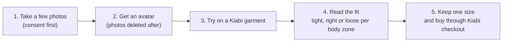
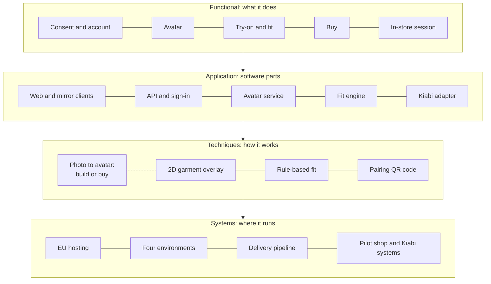
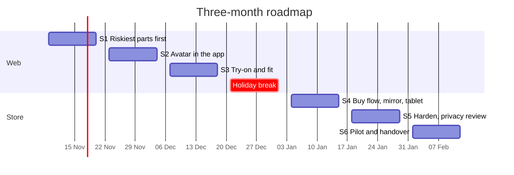

<div align="center">

# Fittybird x Kiabi

### See the clothes on you before you buy.

A photo-based avatar try-on for Kiabi. Web first, then one in-store pilot.


</div>

---

## Contents

- [The problem](#the-problem)
- [The idea](#the-idea)
- [Who it is for](#who-it-is-for)
- [What the pilot must do](#what-the-pilot-must-do)
- [Target architecture](#target-architecture)
- [Roadmap](#roadmap)
- [Risks](#risks)
- [How the team works](#how-the-team-works)
- [Repository guide](#repository-guide)
- [Team](#team)

---

## The problem

Online, nobody can check the fit. Kiabi's own dashboard shows the gap between its two channels:

| Measure | Online | In store |
| --- | :---: | :---: |
| Satisfaction with fitting | **13%** | 75% |
| Customer grade for fitting (out of 10) | **3** | 8 |
| Items returned | **26.5%** | 3.7% |
| Average cart | 67.53 € | 29.08 € |

Fitting is the weakest online stage, and returns are its biggest cost. A customer who uses both the web and the shops is also three times more profitable, but the loyalty card's NFC tag only counts shop entries, so the two channels share no customer data.

*Sources: Kiabi bootstrap brief (pages 1, 3, 4) and Kiabi data deck (slide 6). Details in [`00-bootstrap/`](00-bootstrap).*

## The idea

Fittybird turns a few photos into a personal avatar that wears Kiabi clothes and shows how they fit.



**It is**

- Web first (sprints 1 to 3), then one store pilot with a mirror and a staff tablet (sprints 4 to 6).
- A fit view per body zone, with a size advice the shopper decides on.
- A hand-off to the Kiabi cart and checkout.

**It is not**

- A new checkout or payment system.
- A try-on for children's clothes.
- An exact body scan. Fit is shown as a range, with a size confirmation step.

## Who it is for

Six personas, each built from Kiabi data first. Age, job and city are left out on purpose, because they come from the sprint 1 interviews.

| Persona | Who | Success looks like |
| --- | --- | --- |
| **Léa** | Online shopper, unsure of size | Orders one size, keeps it |
| **Karim** | In-store shopper who dislikes shopping | Fewer trips to the shelves |
| **Nadia** | Shopper who struggles to find a size | Leaves with an item that fits |
| **Lucas** | Budget-conscious trend follower | Fewer returns, more items kept |
| **Inès** | Store associate with a tablet | Fewer wrong-size trips |
| **Claire** | Kiabi e-commerce and marketing | A readable return-rate effect |

Full files: [`2a-personas/`](2a-personas).

## What the pilot must do

The storymap follows the customer in eight activities. Must-have items are what the pilot cannot run without.

| Activity | Must have |
| --- | --- |
| 1. Start and consent | Sign-in, consent before photos, delete my data |
| 2. Create the avatar | Guided photo capture, avatar from photos |
| 3. Browse and choose | Kiabi catalog, filters by category and size |
| 4. Try on | Garment on the avatar, front and back views |
| 5. Judge the fit | Size advice, fit view per body zone |
| 6. Buy | Add to the Kiabi cart, hand off to Kiabi checkout |
| 7. In store | Pairing QR code on the mirror, size request to the staff tablet |
| 8. After purchase | One-question fit feedback and return reason |
| Kiabi team | Event tracking for the KPIs, then a usage and fit dashboard |

Full map with Should and Nice items: [`2b-storymap/`](2b-storymap).

## Target architecture

Four layers, one adapter to Kiabi. Two techniques are still open and are settled by sprint 1 spikes: build or buy for the photo-to-avatar step, and the 2D garment overlay for the try-on.



Key choices (proposed, to be confirmed by the team at the risk sessions):

- **One Kiabi adapter.** Only this component talks to Kiabi systems. We start on a mock feed of 20 articles.
- **EU hosting and four environments,** so no real photo reaches a test system.
- **Photos deleted once the avatar exists.** The avatar stays until the shopper deletes it.
- **Pairing QR code in the pilot,** because the NFC card only counts entries today.

Full file with players, data flows and environments: [`3a-target-architecture/`](3a-target-architecture).

## Roadmap

Twelve working weeks, with the riskiest and most valuable items first. Nothing is planned beyond 2027-02-12.



| Sprint | Dates | Victory to celebrate |
| --- | --- | --- |
| S1 | Nov 9 to Nov 20 | Build-or-buy decided |
| S2 | Nov 23 to Dec 4 | Everyone has their own avatar |
| S3 | Dec 7 to Dec 18 | A garment on a real avatar |
| S4 | Jan 4 to Jan 15 | A size request reaches the staff tablet |
| S5 | Jan 18 to Jan 29 | MVP ready for the pilot |
| S6 | Feb 1 to Feb 12 | Real shoppers use it |

The backlog has **33 items**. The plan uses **112 of 120 person-days** in sprints 1 to 5, which leaves 8 days of slack. Files: [`A-roadmap/`](A-roadmap) and [`C-backlog/`](C-backlog).

**How we prove it works.** The pilot compares shoppers who tried an item on with a control group who saw the same articles without try-on. Our hypothesis is that the return rate on pilot articles falls from 26.5% to 23.5%. It is a hypothesis to test, not a Kiabi figure.

## Risks

19 risks in four types (business, people, technique, timing), scored by likelihood x impact on a 1 to 3 scale. Every risk has an owner and a class: Resolved, Owned, Accepted or Managed.

| Impact → <br> Likelihood ↓ | 1 Low | 2 Medium | 3 High |
| --- | :---: | :---: | :---: |
| **3 High** | amber | **red:** R11, R18 | **red:** R1, R6, R7 |
| **2 Medium** | green | amber: R4, R5, R8, R10, R12, R14, R17 | **red:** R2, R3, R9, R13, R15, R16, R19 |
| **1 Low** | green | green | amber |

The top answers:

- **R6, R7** (no deep 3D or vision experience, avatar fails on poor photos): a sprint 1 spike decides build or buy, and a photo quality check guides the shopper.
- **R9** (photos and body data are sensitive): privacy checklist before any outside photo, full review before the pilot.
- **R18, R19** (technical work uses story capacity, AI and back-end rest on one person): one Should story moves to later, and a back-end backup is named.

Full register with owners and mitigations: [`3b-risks/`](3b-risks).

## How the team works

Two-week Scrum sprints with a Kanban board that limits work in progress to four stories.

| Ritual | When |
| --- | --- |
| Sprint planning | First Monday of a sprint, 1 hour |
| Daily stand-up | Every working day, 10:00, 15 minutes |
| Backlog refinement | Wednesday of week 1, 45 minutes |
| Sprint review | Last Friday, 45 minutes |
| Retrospective and risk review | Same Friday, 45 + 15 minutes |

Every story names one persona. Each review replays one persona's journey. Details: [`B-methodology/`](B-methodology) and [`1b-team-and-rituals/`](1b-team-and-rituals).

## Repository guide

One folder per checkpoint of the EPITECH 360° Framework. The Word files are the source. The PDFs in `submission/` are exports, ready to upload to Gandalf.

```text
.
├── README.md
├── shared/glossary.docx          one meaning per term
├── figures/                      charts and diagrams used by the files
├── 00-bootstrap/                 data analysis, journey maps, growth levers
├── 1a-product-manifesto/         what the product is and is not
├── 1b-team-and-rituals/          roles, interactions, rituals, retro schedule
├── 2a-personas/                  six personas
├── 2b-storymap/                  macro-functionalities by activity
├── 3a-target-architecture/       functional view, components, data flows, environments
├── 3b-risks/                     classified risks, decisions and mitigations
├── A-roadmap/                    three-month roadmap
├── B-methodology/                Scrum and Kanban, rituals, indicators
├── C-backlog/                    backlog, first user stories, decision log
└── submission/                   one PDF per checkpoint
```

| Checkpoint | Source file | PDF to upload |
| --- | --- | --- |
| Bootstrap annexes | `00-bootstrap/` | `submission/00_bootstrap-annexes.pdf` |
| 1a Product manifesto | `1a-product-manifesto/product-manifesto.docx` | `submission/1a_product-manifesto.pdf` |
| 1b Team and rituals | `1b-team-and-rituals/team-roles-and-rituals.docx` | `submission/1b_team-and-rituals.pdf` |
| 2a Personas | `2a-personas/personas.docx` | `submission/2a_personas.pdf` |
| 2a Supporting annexes (not uploaded to Gandalf) | `user-research/01`, `02`, `03` and `Interview_Methodologies/04` | `submission/2a_user-research-strategy.pdf`, `2a_stakeholder-mapping.pdf`, `2a_participant-recruitment-plan.pdf`, `2a_interview-guides.pdf` |
| 2b Storymap | `2b-storymap/storymap.docx` | `submission/2b_storymap.pdf` |
| 3a Target architecture | `3a-target-architecture/target-architecture.docx` | `submission/3a_target-architecture.pdf` |
| 3b Risk management | `3b-risks/risk-management.docx` | `submission/3b_risk-management.pdf` |
| A Roadmap | `A-roadmap/roadmap.docx` | `submission/A_roadmap.pdf` |
| B Methodology | `B-methodology/methodology.docx` | `submission/B_methodology.pdf` |
| C Backlog and decision log | `C-backlog/backlog-and-user-stories.docx` and `decision-log.docx` | `submission/C_backlog-and-decision-log.pdf` |
| Shared glossary | `shared/glossary.docx` | `submission/shared_glossary.pdf` |

### Contributing

1. Edit the Word file in its folder, never the PDF.
2. Record any decision in `C-backlog/decision-log.docx` as a new entry. Old entries are not edited.
3. Export the PDF again and replace it in `submission/`.
4. Commit with a [Conventional Commits](https://www.conventionalcommits.org) message, for example `docs(backlog): add technical items (D15)`.
5. Upload one PDF per checkpoint to Gandalf. Do not upload one large PDF.

## Team

| Name | Role |
| --- | --- |
| **Elie Zaylaa** | Product manager |
| **Boyu Fu** | UX and front-end lead |
| **Muhammad Rao** | AI and back-end lead |
| **Hadeed** | Interview methodology expert |

Each role has a named backup. Who did what is in `CONTRIBUTIONS`.

---

<div align="center">

Fittybird x Kiabi · EPITECH 360° Framework · project initiation

</div>

### Sources

The Kiabi brief, the Kiabi data deck and the EPITECH framework brief are stored in the workspace root next to this repository, not inside it: `360framework-bootstrap.pdf`, `bootstrap-kiabi.pptx` and `360framework-project.pdf`. Course helper decks (`project_helper-*`) are kept in the same location. See `00-bootstrap/01-data-analysis.docx` for the figure-by-figure source notes.
